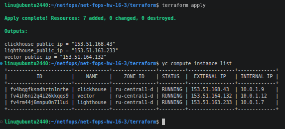
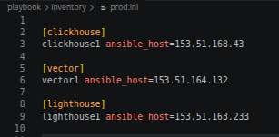
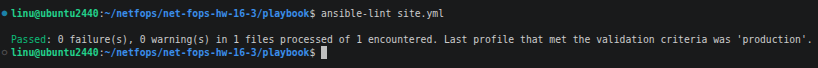
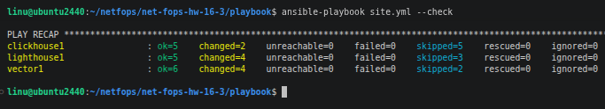
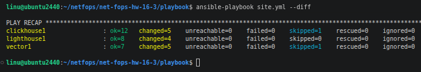
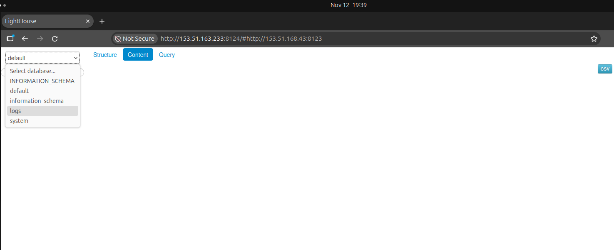
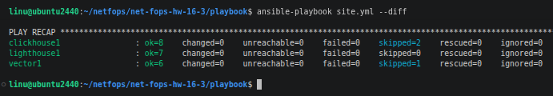

# Домашнее задание к занятию 3 «Использование Ansible» - Розаев А.Ю.

## Подготовка к выполнению

1. Подготовлены в Yandex Cloud три хоста: для `clickhouse`, для `vector` и для `lighthouse`.

2. Использован репозиторий LightHouse [по ссылке](https://github.com/VKCOM/lighthouse).

## Основная часть

1. Дописан playbook: сделан ещё один play, который устанавливает и настраивает LightHouse.
2. При создании tasks использованы модули: `get_url`, `template`, `apt`.
3. Tasks выполняют следущие действия: 
- скачивает статику LightHouse
- устанавливает Nginx
- настраивает его конфиг для открытия LightHouse, запуска веб-сервера
4. При создании инфраструктуры terraform создает статический inventory-файл `prod.ini`.

5. Выполнена проверка `ansible-lint site.yml`, ошибки не зафиксированы.

6. Playbook запущен с флагом `--check`.

7. Playbook запущен на `prod.ini` окружении с флагом `--diff`. Изменения на системе произведены.

8. Повторно запущен playbook с флагом `--diff`, изменеий нет, playbook идемпотентен.

9. Подготовлен [README.md-файл](https://github.com/expgt/net-fops-hw-16-3/blob/08-ansible-03-yandex/playbook/README.md#ansible-playbook-clickhouse-vector--lighthouse-deployment) с описанием, что делает playbook, какие у него есть параметры и теги.

10. Готовый playbook выложен в репозиторий, поставлен тег `08-ansible-03-yandex` на фиксирующий коммит.
